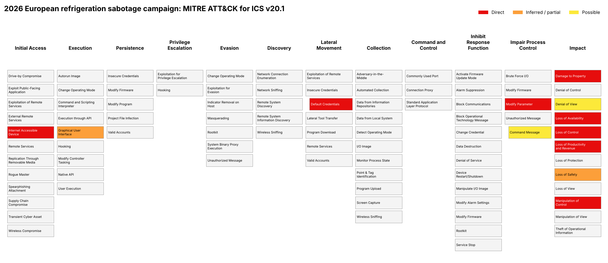

# 2026 European Refrigeration Sabotage Campaign: MITRE ATT&CK for ICS & Enterprise Mapping

> Portfolio project analysing the 2026 cyberattacks on commercial refrigeration controllers in Europe (France, October 2026, and the wider European wave of November 2026) with MITRE ATT&CK for ICS and MITRE ATT&CK Enterprise.
>
> **Framework versions:** MITRE ATT&CK for ICS v20.1 · MITRE ATT&CK Enterprise v20.1 · **Analysis date:** 21 November 2026

## 1. Executive summary

Overnight on 11–12 October 2026, attackers logged into internet-exposed refrigeration controllers at about 700 retail and food sites in France and forced them into long defrost cycles, pushing fridges and freezers to around 50 °C.
Food worth tens of millions of euros was destroyed and at least 15 fires broke out. A second wave on 1–2 November hit food businesses in at least 11 European countries and three sites of France's national blood service (EFS), where staff saved the plasma after alarms fired.
No malware was needed: the controllers (mainly Danfoss AK-SM/AK-SC, plus Copeland and Dixell XWEB) were reachable from the internet and accepted default or weak credentials, so the attackers simply used the controllers' own functions.
On 9 November France attributed the October wave to Shahid Kaveh, an offensive cyber unit of Iran's IRGC (tracked by MITRE as CyberAv3ngers, G1027). The November wave remains unattributed.
**Key lesson:** an internet-facing OT controller with a default password is a remote-control panel for the physical world. Removing internet exposure, changing default credentials and adding an independent temperature alarm would have stopped or contained most of this campaign.

## 2. Attack timeline

| Date (2026) | Event | Source |
| --- | --- | --- |
| Spring | Refrigeration attacks against Israeli targets, including a kosher grocery chain; later described as a rehearsal for France | FDD (citing Profero) |
| Late August | Freezers at at least six US military commissaries switch to defrost overnight; the Pentagon later treats this as a suspected hack (unattributed) | Reuters |
| 9 October | Censys counts 6,695 internet-exposed refrigeration controllers | Censys via SecurityWeek |
| 11–12 October (night) | **Wave 1:** about 700 French sites hit; controllers forced into defrost, temperatures up to about 50 °C; disruption also in Belgium and the Netherlands | CERT-FR, Paris prosecutor, Reuters |
| 12 October | CERT-FR alert CERTFR-2026-ALE-012 (updated 13 October): Danfoss AK-SM/AK-SC, Copeland xweb and Dixell xweb controllers compromised; Paris prosecutor opens an investigation | CERT-FR |
| 25–27 October | A honeypot logs fingerprinting and default-login attempts against a refrigeration interface (reconnaissance lead only, not a confirmed campaign IOC) | DomainTools |
| 1–2 November (night) | **Wave 2:** food businesses in at least 11 European countries; three EFS blood-storage sites targeted with settings toward 110 °C; staff move blood products after alarms | ENISA, Reuters, AP |
| 4 November | EU joint statement (ENISA, European Commission, Europol EC3, EU CSIRTs Network, EU-CyCLONe); NoName057(16) and Z-Pentest post an unverified claim video | ENISA, DomainTools |
| 5 November | US fact sheet (CISA, FBI, HHS, USDA, DoT); Censys finds only 3,124 of the 6,695 controllers still exposed | CISA, Censys |
| 9 November | France attributes Wave 1 to the IRGC unit Shahid Kaveh (C4 report CERTFR-2026-CTI-009); arrest warrants sought for the unit's head and two deputies; Iran's ambassador summoned | French MFA, Paris prosecutor |

## 3. Attack chain (Wave 1, France)

1. **Reconnaissance:** exposed controllers found through internet search engines (FOFA, according to French investigators); the same infrastructure scanned other industrial equipment, including Schneider Electric devices.
2. **Initial access:** direct login to the controller's web interface over the internet, with default or weak credentials. In some cases the path ran through the refrigeration contractor's remote access.
3. **Execution:** the attacker used the controller's normal management functions. No custom malware was reported.
4. **Impair process control:** defrost cycles forced or extended (one store reported an 8-hour defrost) and temperature settings raised.
5. **Impact:** about 50 °C inside fridges and freezers after a few hours, food destroyed, equipment melted, at least 15 fires.

## 4. MITRE ATT&CK for ICS mapping

| # | Phase | ICS tactic | ICS technique | Match | Evidence |
| --- | --- | --- | --- | --- | --- |
| 1 | Exposed controllers | Initial Access | T0883 Internet Accessible Device | Direct | Each controller ran a web server reachable from the public internet; CERT-FR: direct internet exposure is against basic practice |
| 2 | Login | Lateral Movement / Persistence | T1694.001 Default Credentials (Insecure Credentials) | Direct | UK NCSC: fridges "connected directly to the internet with default passwords"; many units accepted `admin` plus the current date |
| 3 | Use of the web UI | Execution | T0823 Graphical User Interface | Inferred | Attackers used the controllers' normal functions; the web interface is the documented management path |
| 4 | Defrost and setpoints | Impair Process Control | T0836 Modify Parameter | Direct | Defrost cycles extended (8 h at one store) and temperature settings raised |
| 4 | Forced defrost command | Impair Process Control | T1692.001 Command Message (Unauthorized Message) | Possible | Media describe a remotely "triggered" forced defrost; whether this was a command or a parameter change is not public |
| 5 | Fridges heat up | Impact | T0831 Manipulation of Control | Direct | Controllers drove units to about 50 °C (150 °C at an Athens butcher in Wave 2) |
| 5 | Fires, melted units | Impact | T0879 Damage to Property | Direct | At least 15 fires; equipment melted; sprinkler water damage |
| 5 | Food destroyed | Impact | T0828 Loss of Productivity and Revenue | Direct | Tens of millions of euros in losses; up to €220,000 for a single store |
| 5 | Cold storage unusable | Impact | T0826 Loss of Availability | Direct | Whole fresh and frozen aisles emptied |
| 5 | Food safety and fire risk | Impact | T0880 Loss of Safety | Partial | Fire hazard and risk of unsafe food; no safety system is reported to have been bypassed |
| 5 | Operators locked out | Impact | T0827 Loss of Control | Direct (Wave 2) | Athens technician needed two hours to regain control |
| 5 | Temperatures not visible | Impact | T0815 Denial of View | Possible | Listed as a possible impact by the US fact sheet; not confirmed in the European incidents |

_Navigator layer: [`layers/ics-layer.json`](layers/ics-layer.json) (open it in the [ATT&CK Navigator](https://mitre-attack.github.io/attack-navigator/) and choose the ICS domain)_

## 5. MITRE ATT&CK Enterprise mapping (IT side)

| # | Phase | Enterprise technique | Match | Evidence |
| --- | --- | --- | --- | --- |
| 0 | Finding targets | T1596.005 Scan Databases | Direct | FOFA used for target discovery, according to French investigators |
| 0 | Scanning industrial gear | T1595 Active Scanning | Direct | Shared infrastructure scanned Schneider Electric systems (Modbus/TCP 502) |
| 1 | Default login | T1078.001 Default Accounts | Direct | Default or weak passwords on the controllers |
| 1 | Contractor path | T1199 Trusted Relationship | Direct (some victims) | Les Mousquetaires: attack came through a refrigeration contractor; EFS: through the provider Coolworld |

_Navigator layer: [`layers/enterprise-layer.json`](layers/enterprise-layer.json)_

## 6. Comparison with CyberAv3ngers (G1027) in ATT&CK

France names Shahid Kaveh, which US agencies identify with CyberAv3ngers (MITRE ATT&CK group G1027). Comparing this campaign with the techniques ATT&CK already lists for G1027 (mostly from the 2023 Unitronics PLC attacks):

| ATT&CK technique | G1027 (2023 Unitronics) | 2026 refrigeration campaign |
| --- | --- | --- |
| T0883 Internet Accessible Device | Yes | Yes |
| T1694.001 Default Credentials | Yes | Yes |
| T1692.001 Command Message | Yes | Possible |
| T0879 Damage to Property | Yes | Yes |
| T0880 Loss of Safety | Yes | Partial |
| T0826 Loss of Availability | Yes | Yes |
| T0827 Loss of Control | Yes | Yes (Wave 2) |
| T0892 Change Credential | Yes | Not reported |
| T0889 Modify Program / T0843 Program Download | Yes | Not reported (no malware) |
| T0836 Modify Parameter | Not listed | Yes (new for this group) |

The same pattern holds: internet-exposed OT, default passwords, and physical impact. The 2026 campaign did not need to alter controller programs; changing parameters was enough.

## 7. Detection opportunities (SOC view)

| Phase | What a SOC or operator could have seen |
| --- | --- |
| 0. Reconnaissance | Requests for version or metadata files and default-login attempts on refrigeration web interfaces; the asset showing up in Censys, Shodan or FOFA results |
| 1. Exposure | External attack-surface scan finding OT web interfaces on public IPs, often set up by contractors outside IT's inventory |
| 2. Login | Successful logins from foreign or hosting-provider IPs; logins at night when the store is closed; the `admin` account used from a new location |
| 3–4. Changes | Setpoint or defrost-schedule changes outside maintenance windows; the same change pushed to many sites within minutes; defrost durations far beyond normal |
| 5. Impact | Temperature rising across many units at once; alarms in several stores the same night (a pattern, not a single fault); loss of telemetry |
| Contractor path | Contractor remote-access sessions outside agreed hours or from unexpected sources |

## 8. Countermeasures

ATT&CK mitigation IDs come from ATT&CK for ICS v20.1. NIST and ISO columns show the most relevant controls selected by the analyst.

| Phase | ATT&CK for ICS mitigation | NIST 800-53 Rev5 | ISO 27001:2022 |
| --- | --- | --- | --- |
| 1. Exposure | M0930 Network Segmentation; remove direct internet exposure, reach controllers only through a VPN or protected network | SC-7, AC-17, CM-7 | A.8.20, A.8.22 |
| 2. Login | M0927 Password Policies; M0801 Access Management; change every default password, enable the vendor's strict security mode, MFA where supported | IA-5, IA-2(1), AC-2 | A.5.17, A.8.5 |
| 3–4. Changes | M0800 Authorization Enforcement; M0804 Human User Authentication; M0947 Audit; allowlist who may change setpoints and log every change | AC-3, AC-6, AU-2, AU-6 | A.8.2, A.8.15, A.8.16 |
| 4. Unsafe values | M0818 Validate Program Inputs; enforce hard limits on setpoints and defrost duration | SI-10 | A.8.28 |
| 5. Physical impact | M0805 Mechanical Protection Layers (e.g. a hardware high-temperature cut-off); M0812 Safety Instrumented Systems | PE-14, SI-17 | A.7.5, A.7.11 |
| 5. Detection and recovery | M0810 Out-of-Band Communications Channel (independent temperature monitoring with its own alarms); M0953 Data Backup of controller configurations | SI-4, CP-9, CP-10 | A.8.13, A.8.16 |
| Lifecycle | Update firmware; replace end-of-life controllers (AK-SC355 end-of-life 2016, AK-SM800 May 2021) | SI-2, SA-22 | A.8.8 |
| Contractor path | Contractor access only through managed, logged remote access; supplier security requirements (NIS2) | SA-9, AC-17(1), SR-6 | A.5.19, A.5.21 |

_The EFS incident shows why independent monitoring matters: alarms fired, staff moved the blood products, and the plasma was saved._

## 9. Open questions & limitations

- **No public forensic report.** The French C4 attribution report is five pages long; no technical indicators of compromise have been published.
- **Vulnerability or just bad passwords?** Danfoss AK-SM800A units have known CVEs (e.g. CVE-2025-41450, authentication bypass), and Claroty described a hidden "code of the day" login based on the device date. ANSSI, however, says the known Danfoss vulnerabilities were not used and points to basic security failures. Whether the widely reported "`admin` + current date" login is a documented default or the hidden bypass is not fully clear. This analysis therefore maps T1694.001 / T1078.001 rather than T0866 / T1190.
- **Parameter change vs command (T0836 vs T1692.001):** public sources do not say whether the forced defrost was set through a parameter or sent as a command. Both are listed, with T1692.001 marked "possible".
- **Why no alarms?** In the stores no alarm reportedly triggered overnight, while at EFS the alarms worked. It is unknown whether alarms were suppressed (T0878) or simply not configured. T0878 is not mapped.
- **Attribution covers Wave 1 only.** France attributes the October wave to Shahid Kaveh, citing shared infrastructure, industrial reconnaissance, Farsi traces and a linked propaganda outlet. The November wave is not attributed. NoName057(16) and Z-Pentest claimed it without evidence; Romania's cyber director did not suspect a state actor; Iran routinely denies such operations.
- **Unit names are disputed.** France links Shahid Kaveh to the Cyber Isnaad Front persona; FDD links that persona more closely to another IRGC unit, Shahid Shushtari.
- **Copycats are likely.** The technique is simple and public, so later incidents may be unrelated to the original actor.
- **US commissaries (August) and Israel (spring)** are listed for context only; no official link to the European waves has been published.
- **Loss and fire figures vary.** Sources give "at least 15" or "around 20" fires and different loss totals. This analysis uses the lower, officially reported figures.

## 10. Sources

- [CERT-FR: alert CERTFR-2026-ALE-012 (via Refindustry summary)](https://refindustry.com/news/french-cybersecurity-agency-warns-of-attacks-on-refrigeration-controllers/)
- [CISA, FBI, HHS, USDA, DoT: Hardening Industrial Refrigeration and Cold Chain Monitoring Systems (5 Nov 2026)](https://www.ic3.gov/CSA/2026/261105.pdf)
- [ENISA: Joint statement on cyber incidents in refrigeration systems across the EU](https://www.enisa.europa.eu/news/joint-statement-on-cyber-incidents-in-refrigeration-systems-across-the-eu)
- [The Record: France blames Iran for fridge cyberattacks, says some caused fires](https://therecord.media/france-blames-iran-for-fridge-cyberattacks)
- [DomainTools Investigations: European Refrigeration Systems Cyber Sabotage](https://dti.domaintools.com/research/european-refrigeration-systems-cyber-sabotage)
- [Industrial Cyber: French supermarket cyberattack exposes risks of unsecured remote access](https://industrialcyber.co/control-device-security/french-supermarket-cyberattack-exposes-risks-of-unsecured-remote-access-and-legacy-refrigeration-systems/)
- [AP / PBS: Here's what to know about another cyberattack on European supermarket fridges](https://www.pbs.org/newshour/world/heres-what-to-know-about-another-cyberattack-on-european-supermarket-fridges)
- [Sysdream: Accès distant prestataires OT, la leçon des frigos piratés](https://sysdream.com/blog/acces-distant-prestataires-ot/)
- [FDD: France Is Latest Victim of Iranian Cyber Sabotage First Unleashed on Israel](https://www.fdd.org/analysis/france-is-latest-victim-of-iranian-cyber-sabotage-first-unleashed-on-israel/)
- [Reuters via Taiwan News: Pentagon treating commissary freezer malfunctions as suspected hack](https://taiwannews.com.tw/en/news/6468179)
- [Wikipedia: 2026 European refrigerator hacks](https://en.wikipedia.org/wiki/2026_European_cold_chain_hacks)
- [MITRE ATT&CK for ICS](https://attack.mitre.org/matrices/ics/) · [CyberAv3ngers G1027](https://attack.mitre.org/groups/G1027/) · [ATT&CK STIX data](https://github.com/mitre-attack/attack-stix-data)

## License & attribution

© 2026 PARTSI14. This analysis is released under the MIT License (see [LICENSE](LICENSE)).

MITRE ATT&CK® is a registered trademark of The MITRE Corporation; ATT&CK content © The MITRE Corporation. This project is not affiliated with or endorsed by MITRE or any vendor named. All incident facts come from the public sources listed in section 10.
